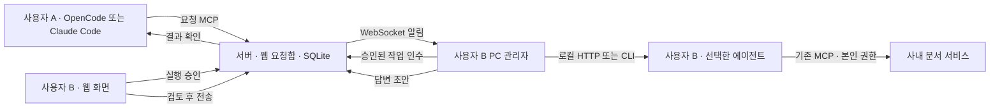

# MCP Queue

서로 다른 PC를 쓰는 **두 사용자, 사용자당 에이전트 한 개**를 연결하는 최소 프로토타입입니다. 사용자는 **OpenCode 또는 Claude Code**를 선택할 수 있으며 서로 다른 도구를 쓰는 사용자끼리도 요청·승인·초안 검토·최종 회신이 가능합니다.

중앙 서버는 Docker Compose로 실행합니다. 각 PC의 작은 관리자가 WebSocket으로 연결하고, **수신자가 승인한 작업만** OpenCode 로컬 HTTP API 또는 Claude Code CLI로 전달합니다. 사내 문서는 각 사용자가 설정한 문서 MCP로 읽습니다.



## 어디에 무엇을 설치하나요?

| 위치 | 설치 | 보관하는 설정 |
| --- | --- | --- |
| 중앙 서버 1대 | Git, Docker Engine/Desktop, Compose v2 | 사용자별 토큰의 해시, 요청 DB. 최초 설정도 Docker로 가능하므로 Node.js 별도 설치 불필요 |
| 사용자 A PC | Node.js 22.16 이상, OpenCode 또는 Claude Code, 이 저장소의 PC 관리자. Git은 다운로드 방법으로 권장 | A 본인의 토큰 묶음, 모델 API/로그인 및 문서 MCP 설정 |
| 사용자 B PC | A와 동일 | B 본인의 토큰 묶음, 기존 GLM API 및 문서 MCP 설정 |
| 사용자 브라우저 | 추가 설치 없음 | 웹 화면에 사람용 토큰 입력. 토큰은 페이지 메모리에서만 사용 |

사용자 PC는 Docker 없이 동작합니다. PC 관리자는 호스트에서 실행하며 선택한 에이전트 어댑터를 사용합니다. 서버 컨테이너가 사용자 PC의 프로세스를 직접 실행하지 않습니다.

| 주소 | 용도 | 열리는 조건 |
| --- | --- | --- |
| `http://localhost:3000` | MCP Queue 웹 요청함 | 서버 Compose 실행 |
| `http://127.0.0.1:4096` | 사용자 PC의 OpenCode API | 해당 PC에서 OpenCode를 별도 실행 |
| Claude Code | 로컬 CLI로 실행. 4096 포트 불필요 | CLI 설치와 인증 설정 |

4096은 Queue 웹 주소가 아닙니다. 이 프로젝트가 OpenCode를 자동 설치·실행하지 않으므로 OpenCode를 켜지 않았다면 연결이 거부되는 것이 정상입니다.

## 서버 빠른 시작

Windows PowerShell 기준입니다. Linux 절차와 사내 접속 구성은 [서버 설치](docs/server.md)를 보세요.

```powershell
git clone https://github.com/cwj980119/mcp-queue.git
cd mcp-queue
docker compose --profile tools run --rm setup
docker compose up -d --build --wait
```

http://localhost:3000 에서 웹 화면을 엽니다. 최초 설정은 `.local/alice`, `.local/bob`을 생성하며, **각 사용자에게 자신의 폴더만** 전달합니다. 같은 명령을 다시 실행해도 기존 자격증명을 덮어쓰지 않습니다.

실제 두 PC에서 접속할 때는 최초 setup 전에 `.env`에 `QUEUE_SERVER_URL=https://queue.company.example`처럼 두 PC가 접근할 주소를 설정하세요. 기본 Compose는 localhost에만 포트를 엽니다. [사내 HTTPS 연결 안내](docs/server.md#다른-pc에서-접속)를 따라 기존 리버스 프록시에 연결할 수 있습니다.

## 사용자 시작

자신의 묶음을 저장소의 `.local/alice` 또는 `.local/bob`에 놓습니다. **OpenCode 사용자는** [사용자 설치](docs/user.md)를 따르세요. 핵심 절차는 다음과 같습니다.

1. 기존 OpenCode 설정에 본인의 `opencode-mcp.json` 내용을 **병합**합니다. 기존 GLM·문서 MCP 설정을 덮어쓰지 않습니다.
2. `examples/opencode-reader.json`의 `queue-reader` 설정을 병합하고, 허용할 **실제 문서 검색·읽기 도구 이름**만 지정합니다.
3. `manager.json`에 기존 OpenCode 프로젝트 절대 경로와 로컬 OpenCode 비밀번호를 설정합니다.
4. 해당 프로젝트에서 `opencode --hostname 127.0.0.1 --port 4096`을 실행하고, 별도 터미널에서 관리자를 시작합니다.

```powershell
npm.cmd ci
npm.cmd run build
npm.cmd run manager -- .local/bob/manager.json
```

웹 화면에는 `human-token.txt` 값을 입력합니다. 에이전트·관리자용 토큰으로는 실행 승인과 최종 전송을 할 수 없습니다.

**Claude Code 사용자는** [Claude Code 설치 안내](docs/claude-code.md)를 따릅니다. 기존 사용자 묶음이라면 아래 명령으로 같은 토큰을 사용하는 설정만 추가합니다. 서버 setup을 다시 실행하지 않습니다.

```powershell
npm.cmd run config:claude -- .local/bob
# manager.claude.json의 프로젝트 경로, 문서 MCP 파일, 도구 이름을 수정한 뒤:
npm.cmd run manager -- .local/bob/manager.claude.json
```

`manager.json`의 `runtime: "opencode"` 또는 `manager.claude.json`의 `runtime: "claude-code"`로 실행 도구를 선택합니다. 기존 runtime 항목이 없는 설정은 OpenCode로 동작합니다. 같은 사용자로 관리자 두 개를 동시에 켜서 다른 런타임 사이에 작업이 임의 분배되게 하지 마세요.

## 사용하는 흐름

1. A가 에이전트에 “queue MCP로 bob에게 문서 DOC-42의 v3 검토를 요청해줘”라고 말하거나 웹에서 요청을 작성합니다.
2. B의 받은 요청함에 요청이 보입니다. B가 **내 에이전트 실행 승인**을 누릅니다.
3. B PC 관리자가 알림을 받고 작업을 인수합니다. 오프라인이었다면 재연결할 때 확인합니다.
4. B의 OpenCode가 자신의 문서 MCP 권한으로 문서를 읽고 초안을 만듭니다.
5. B가 초안을 수정·검토한 뒤 **검토한 답변 최종 전송**을 누릅니다.
6. A는 보낸 요청함이나 `get_request`로 결과를 읽습니다. 회신만으로 A의 에이전트가 자동 실행되지는 않습니다.

## 구현과 재사용

- **서버:** TypeScript, Express, 공식 MCP TypeScript SDK, ws, Node 내장 SQLite.
- **PC 관리자:** TypeScript, WebSocket 알림, REST 작업 인수, OpenCode HTTP/Claude Code CLI 어댑터. Claude 문서 MCP는 공식 SDK로 만든 도구 필터를 거칩니다.
- **웹:** HTML/CSS/JavaScript. 별도 웹 빌드 도구나 프레임워크가 없습니다.
- **재사용:** TinyTask의 트랜잭션 기반 작업 인수 코드를 이식·수정했습니다. MCP 프로토콜은 공식 SDK를 사용합니다. OpenAgentEmail과 Paperclip은 소스와 문서를 읽고 요청·회신 및 어댑터 설계에 참고했습니다. 전체 서비스들을 중복 배포하지 않습니다. 리비전·이식 범위·라이선스는 [THIRD_PARTY_NOTICES.md](THIRD_PARTY_NOTICES.md)에 기록했습니다.

## 검증

```powershell
npm.cmd ci
npm.cmd test
# 서버가 위의 Compose로 실행 중이며 .local에 두 사용자 설정이 있을 때:
npm.cmd run test:compose
```

Compose 검증은 `[SMOKE]` 요청 2개를 생성해 양방향 요청·승인·초안·회신을 확인합니다. 실제 MCP·REST·WebSocket과 PC 관리자 코드를 사용하고 **OpenCode·GLM·사내 문서 서비스는 모의 응답**으로 대체합니다. 실제 GLM 토큰을 사용하지 않습니다. 실제 사내 서비스 연결은 사용자 설정 후 별도 확인해야 합니다.

기본 테스트는 권한 분리, 초안 비공개, 중복 생성, 동시 작업 인수, 재접속 시 작업 확인, 오래된 실행 결과 차단도 확인합니다.

OpenCode ↔ Claude Code 혼합 통신도 모의 런타임으로 검증합니다. Compose에서도 실행하려면 PowerShell에서 `$env:QUEUE_SMOKE_MIXED='1'` 후 `npm run test:compose`를 사용합니다. Claude Code 어댑터·도구 필터·실패·취소 처리도 테스트에 포함됩니다. Claude Code의 실제 모델 응답과 사내 인증 연동은 사용자 환경에서 별도 확인해야 합니다.

검증 환경에서 실제 OpenCode **1.19.5**를 별도 Docker 컨테이너에 띄워 읽기 프로필 로딩·상태 API·빈 세션 생성·메시지 API 스키마를 확인했습니다. 모델 프롬프트는 보내지 않았으며 GLM·문서 MCP 연동 완료를 의미하지 않습니다. 사용자 PC에서 같은 계약 검사를 하려면 `npm run test:opencode-contract`를 사용합니다. 자세한 환경변수는 [사용자 설치 문서](docs/user.md#연결-계약-확인모델-호출-없음)를 참고하세요.

## 현재 범위와 운영 특성

사용자별 동시 작업은 1개이며, 목록은 최신 200개를 보여줍니다. 대기 중에는 LLM 호출이 없습니다. 연결 유지 ping과 60초 간격의 REST 복구 확인은 일반 프로그램이 수행하므로 모델 토큰을 사용하지 않습니다. 작업 중에는 문서 읽기·모델 추론에 따라 토큰을 사용합니다.

실패하거나 중단된 작업은 자동 재실행하지 않습니다. OpenCode HTTP 취소는 원격 실행 중단을 보장하지 않으며, Claude Code CLI는 취소 시 로컬 프로세스에 종료 신호를 보내지만 하위 프로세스나 이미 수행한 효과까지 되돌리지 않습니다. 웹의 **중단된 실행으로 표시**도 프로세스를 종료하지 않습니다. 로컬 세션을 확인한 뒤 사람이 재승인해야 합니다. 완성된 초안은 로컬 outbox에 보관해 모델 재실행 없이 전송을 재시도합니다.

이 버전에는 SSO, 워크그룹, 에이전트 자동 선택, 분산 서버, 문서별 ACL 전달 판정, OS 샌드박스가 없습니다. 실행 권한은 OpenCode의 제한된 `queue-reader` 설정으로 제어합니다. 서버에는 문서 참조뿐 아니라 **질문·생성된 초안·최종 답변도 저장**되므로 공유 가능한 내용만 전송해야 합니다. [구조 및 한계](docs/architecture.md)를 참고하세요.
