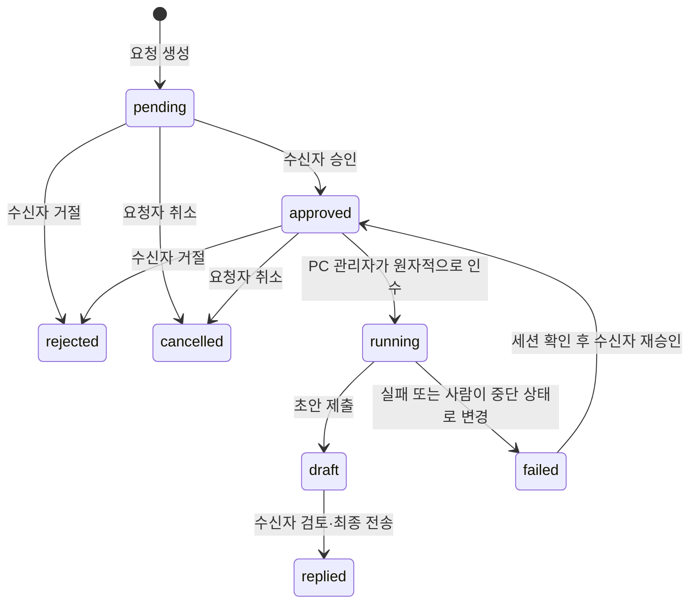

# 최소 구조와 실패 처리

## 책임 분리

| 구성 | 책임 | LLM 호출 |
| --- | --- | --- |
| 중앙 서버 | 인증·역할 확인, 요청 상태, SQLite 기록, 알림, 웹 UI, MCP 네 도구 | 없음 |
| PC 관리자 | 연결 유지, 승인된 요청 인수, 고정된 로컬 프로젝트의 OpenCode HTTP 또는 Claude Code CLI 호출, 결과 전달 | 직접 호출 없음. 작업이 있을 때 선택한 런타임 호출 |
| OpenCode/Claude Code | 사용자 모델 설정과 문서 MCP로 질문 처리 | 실행 중에 발생 |
| 사람 | 실행 여부 결정, 결과·공유 권한 검토, 최종 전송 | 해당 없음 |

서버는 문서 서비스를 대신 호출하지 않습니다. 문서 URL을 서버에서 자동으로 HTTP fetch하지 않으며 각 사용자의 OpenCode가 기존 문서 MCP로 처리합니다. 임의 웹 URL을 실행 명령이나 로컬 경로로 바꾸지 않습니다.

PC 관리자의 `runtime`으로 OpenCode 또는 Claude Code를 선택합니다. OpenCode는 고정된 loopback API에 접속하며, Claude Code는 설정된 로컬 실행 파일을 shell 없이 실행하고 요청을 stdin으로 전달합니다. 사용자당 실행 슬롯과 승인·회신 상태는 런타임에 관계없이 동일합니다. 이미 실행 중인 대화에 메시지를 삽입하지 않고 요청별 새 세션을 만듭니다.

Claude Code 수신 작업은 명시한 문서 MCP만 로드합니다. 공식 MCP SDK로 만든 로컬 stdio 프록시가 허용한 정확한 도구 이름만 목록에 제공하고 직접 호출도 검사합니다. 내장 도구는 CLI 옵션으로 비활성화하며 자동 허용 목록만을 도구 차단 수단으로 사용하지 않습니다. user/project/local settings 자동 로딩은 끄므로 모델 API 환경변수는 관리자 실행 환경에서 제공해야 합니다. OAuth 문서 MCP의 Claude 자격증명 저장소 연동은 아직 구현하지 않았습니다.

## 상태

실행 승인은 해당 요청에 대한 한 번의 승인입니다. 요청 내용·수신자·문서 참조는 생성 후 변경하지 않습니다. 완료·거절·취소된 요청은 읽기만 가능하며 추가 질문은 새 요청으로 보냅니다.

## 자격증명

| 역할 | 허용 | 불가 |
| --- | --- | --- |
| human | 자신의 요청 읽기·생성, 수신 승인·거절·전송, 발신 취소 | 다른 사용자의 요청 열람 |
| agent | 본인의 요청 생성·열람, MCP 네 도구 | 실행 승인·최종 전송·작업 인수 |
| worker | 본인에게 승인된 작업 인수, 세션 기록, 초안·실패 제출, 본인 요청 읽기 | 요청 생성·실행 승인·최종 전송 |

MCP는 agent 키만 받습니다. 사람은 회사 OIDC Authorization Code + PKCE로 로그인하며 `issuer + sub`로 자동 등록됩니다. 브라우저는 HttpOnly·SameSite 세션 쿠키와 CSRF 토큰을 사용하고 HTTPS에서는 Secure 쿠키를 씁니다. 에이전트에는 사람용 키를 전달하지 않습니다. PC별 agent/worker 키는 발급 시 한 번 반환하고 서버 DB에는 해시만 저장합니다. 만료·본인 폐기 API를 지원하며 모든 요청과 WebSocket 연결 유지 때 유효성을 재검사합니다. OIDC ID/access/refresh token은 DB에 저장하지 않습니다. MFA는 회사 IdP 정책에 따릅니다. 회사 계정 비활성화/전체 SSO 로그아웃의 실시간 세션 폐기, 그룹 정책, 요청 rate limit은 아직 없습니다.

에이전트가 수신자의 권한으로 악성 요청·문서를 읽을 가능성을 고려해 OpenCode 프로필을 읽기 도구만 허용하도록 설정합니다. 이것은 OS 컨테이너 격리나 문서 ACL 검증을 대신하지 않습니다. 로컬 관리자나 사용자 계정이 침해되면 그 사용자의 권한을 신뢰할 수 없습니다.

## 이벤트와 재접속

1. 서버가 SQLite에 작업·이력을 커밋합니다.
2. 참여자에게만 `{ type: changed, id, state }` WebSocket 힌트를 보냅니다. 초안 내용은 알림에 싣지 않습니다.
3. PC 관리자는 REST claim으로 실제 대기 상태를 확인합니다.
4. 시작 시·재접속 시·60초 간격에도 확인합니다. 알림이 유실되어도 승인된 작업은 DB에 남습니다.

알림 전달의 exactly-once는 보장하지 않습니다. 서버 DB가 기준이며 중복 알림은 같은 실행을 두 번 시작하지 않습니다. `/events` 연결은 최초 메시지로 인증하므로 토큰이 URL에 남지 않습니다. WebSocket ping/pong은 모델이 아닌 프로그램 차원의 연결 유지입니다.

## 중복·실패

- **생성 재시도:** `(sender, idempotencyKey)`가 유일합니다. 같은 키·같은 내용이면 기존 요청을 반환하고, 내용이 다르면 409입니다.
- **동시 작업 인수:** `BEGIN IMMEDIATE` 트랜잭션 안에서 선택·갱신합니다. recipient별 running 행의 unique partial index도 둡니다.
- **늦은 결과:** 매번 새 `runId`를 발급하고 현재 실행과 일치하는 결과만 받습니다. 과거 실행의 답변으로 새 실행을 덮어쓸 수 없습니다.
- **회신 전 장애:** 초안/실패 결과를 PC의 디스크 outbox에 먼저 저장한 뒤 전송합니다. 재전송은 API 호출만 반복하고 LLM을 다시 실행하지 않습니다.
- **응답 유실:** 서버가 이미 저장했는데 응답만 유실되면 재조회해 같은 runId·같은 내용인지 확인하고 outbox를 지웁니다.
- **실행 중 PC 종료:** 작업을 running으로 유지합니다. 만료 시간으로 자동 재실행하지 않습니다. 세션을 확인한 사람이 중단 표시·재승인을 해야 합니다.
- **프로세스 종료:** 정상 Ctrl+C는 진행 중 HTTP 대기를 취소하고 가능한 경우 실패 결과를 저장합니다. 강제 종료·디스크 장애·OpenCode 측 실행 중단은 보장하지 않습니다.

이 시스템은 임의 업무의 exactly-once 실행을 보장하지 않습니다. 먼저 문서 질문처럼 읽기 작업으로 범위를 제한했습니다. 향후 외부 쓰기를 추가할 경우 대상 서비스의 멱등 키·작업별 승인·보상 절차가 필요합니다.

## 병목과 이후 확장

| 현재 선택 | 한계 | 필요할 때의 변경 |
| --- | --- | --- |
| SQLite·단일 서버 | 동기 DB 작업이 이벤트 루프를 점유, 여러 서버로 scale-out 불가 | PostgreSQL과 트랜잭션 claim, outbox 이벤트 발행 |
| 메모리 WebSocket 연결 | 서버 재시작 시 연결 종료, 다중 서버 알림 공유 없음 | 현재는 REST 재확인. 여러 서버가 되면 Redis/NATS pub/sub를 알림 전파에 추가 |
| OIDC 동적 사용자·PC별 키 | 그룹·권한 위임, 관리자 계정 차단, IdP 로그아웃 연동 없음 | 사용자 비활성화·그룹 테이블·역할 정책·IdP back-channel logout |
| 사용자당 실행 1개 | 긴 문서 하나가 다음 승인 작업을 지연 | 명시적 에이전트 슬롯과 사용자 총 RPM 제한. 우선 현재 60회/분 제약 측정 |
| 제한된 문서 프로필 | 문서별 읽기/공유 권한을 서버가 알 수 없음 | 문서 서비스 권한 확인 API와 산출물 공유 정책 연동 |
| OpenCode API 의존 | 버전·에이전트 도구 동작 차이 | `src/opencode.ts` 어댑터 교체, 실제 설치 버전 계약 테스트 |
| 최신 목록 200개 | 오래된 요청 탐색·검색 미제공 | 커서 페이지네이션과 검색. ID로는 기존 요청 조회 가능 |
| 프롬프트·세션 길이 | 긴 원문은 모델 비용·지연 증가 | 문서 MCP 검색/발췌/버전 참조, 답변 길이 제한, 호출량 관측 |

초기 50명×3에이전트 전체를 수용하는 오케스트레이터는 이 버전의 범위가 아닙니다. 현재는 두 사용자의 승인·회신 경로와 기존 사내 문서 MCP의 실제 호환성을 먼저 확인하도록 구성했습니다.

## 토큰 계산의 기준

대기 중 관리 프로그램/서버의 모델 토큰은 **0**입니다. 작업당 사용량은 `모델 입력 토큰 합 + 출력 토큰 합`이며, 문서 도구 결과와 반복 문맥도 입력에 포함됩니다. 사내 GLM 제공자의 실제 사용량 메타데이터가 없으므로 이 프로토타입은 토큰 수·금액을 측정했다고 주장하지 않습니다. OpenCode가 세션 생성·요약에 내부 모델 호출을 추가할 수도 있습니다. 단계 수×문서 크기만으로 금액을 확정할 수 없습니다.

실제 연결 확인 때 요청 5~10개를 수행하고 사용자별 분당 호출 수, 총 입력/출력 토큰, 첫 응답 및 완료 시간, 문서 도구 결과 크기를 사내 게이트웨이/OpenCode에서 측정한 뒤 60회/분 예산에 맞춰 조정하세요. 별도 LLM heartbeat를 추가할 필요는 없습니다.
